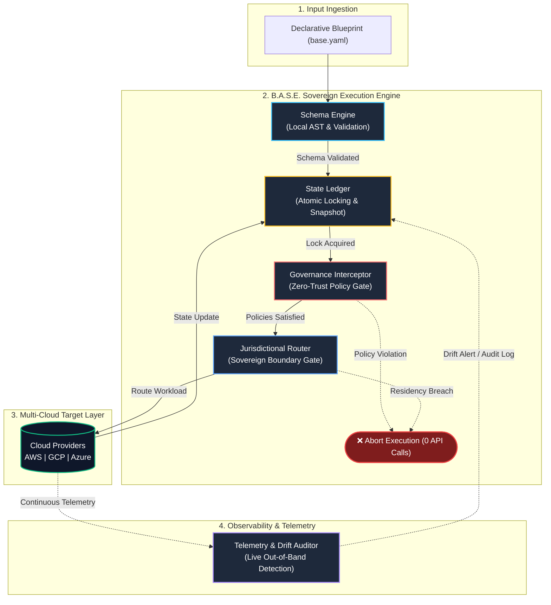

# B.A.S.E. — Boundary-Aware Sovereign Engine
### RFC-001: Architecture Specification, System Design & Governance Framework


---

## 1. Executive Summary & Core Thesis

**B.A.S.E.** (Boundary-Aware Sovereign Engine) is a declarative, multi-cloud infrastructure orchestration and pre-flight policy governance framework[cite: 1]. 

Conventional Infrastructure-as-Code (IaC) engines operate downstream: they parse static configuration files and translate them into remote cloud API calls, relying on post-provisioning scanners or runtime monitors to flag misconfigurations after resources have already been deployed[cite: 1]. 

B.A.S.E. shifts the governance lifecycle **strictly upstream** through a local pre-flight interception model[cite: 1]:
* **Zero Out-of-Boundary Execution:** Synthesized infrastructure topologies are validated locally against policy constraints before any network packet is dispatched to a cloud API[cite: 1].
* **Cryptographic State Integrity:** Distributed state locking prevents concurrency collisions across distributed teams and automated CI/CD pipelines[cite: 1].
* **Jurisdictional Sovereignty:** Workloads and data volumes are cryptographically bound to approved geopolitical boundaries, preventing cross-border replication or unauthorized foreign data egress[cite: 1].
* **Autonomous Drift Reconciliation:** Continuous background telemetry compares live cloud infrastructure against the cryptographically signed baseline, producing auditable compliance logs[cite: 1].

---

## 2. High-Level System Architecture



---

## 3. The Five Core Architectural Components

### Component 1: Core Execution & Schema Engine
* **Purpose:** Serves as the primary parser and syntax validation engine[cite: 1].

### Component 2: Distributed State & Locking Ledger
* **Purpose:** Establishes transactional state integrity and prevents race conditions across distributed teams and automated CI/CD runners[cite: 1].


### Component 3: Pre-Flight Governance Interceptor
* **Purpose:** Enforces organizational security standards, compliance baselines, and zero-trust policies prior to network transmission[cite: 1].

### Component 4: Jurisdictional & Data Residency Router
* **Purpose:** Enforces data sovereignty and geopolitical operational boundaries at the infrastructure topology layer[cite: 1].

### Component 5: Continuous Telemetry & Drift Auditor
* **Purpose:** Provides ongoing compliance verification and state drift detection across live environments[cite: 1].

---

## 4. Blueprint Specification Schema (Conceptual Design)

Infrastructure configurations are expressed via a unified declarative blueprint defining security baselines, jurisdictional boundaries, and multi-cloud infrastructure resources in a single structure[cite: 1]:

```yaml
version: "1.0-draft"
metadata:
  blueprint: "enterprise-sovereign-vault"
  owner: "Verity Analyst Consulting Inc."
  environment: "production"

# Upstream Governance & Jurisdictional Boundaries
governance:
  frameworks:
    - "ABC"
    - "DEF"
  enforce_encryption_at_rest: true
  enforce_encryption_in_transit: true
  block_public_ingress: true
  jurisdiction:
    allowed_regions:
      - "ca-central-1"
    prohibit_cross_border_egress: true

# Target Multi-Cloud Endpoints
providers:
  primary:
    target: "aws"
    region: "ca-central-1"
  secondary:
    target: "gcp"
    region: "northamerica-northeast1"

# Managed Resource Topologies
topology:
  - id: "core-isolated-network"
    type: "network.vpc"
    provider: "primary"
    spec:
      cidr: "10.100.0.0/16"
      flow_logs_enabled: true
      routing: "private-isolated"

  - id: "secure-transaction-datastore"
    type: "database.managed_relational"
    provider: "primary"
    dependencies: ["core-isolated-network"]
    spec:
      engine: "postgres"
      storage_encrypted: true
      kms_key_binding: "arn:aws:kms:ca-central-1:corporate-sovereign-key"
      multi_az: true
      public_endpoints: false

  - id: "immutable-audit-vault"
    type: "storage.object_store"
    provider: "primary"
    spec:
      versioning: true
      encryption: "kms"
      kms_key_binding: "arn:aws:kms:ca-central-1:corporate-sovereign-key"
      block_public_access: true
      retention_lock_days: 2555
```

---

## 5. Pre-Flight Governance Logic Model

The execution pipeline evaluates incoming configuration blocks through sequential, deterministic validation rules prior to provisioning[cite: 1]:

```text
                  +-----------------------------------+
                  |  Evaluate Resource Configuration  |
                  +-----------------+-----------------+
                                    |
                                    v
                 /-------------------------------------\
                <  Is Storage / Volume Encrypted (KMS)? >
                 \-------------------------------------/
                                    |
                         No         |         Yes
           +------------------------+------------------------+
           |                                                 |
           v                                                 v
+-----------------------+                         /---------------------\
| EMIT: Policy Violation|                        < In Authorized Region? >
| STATUS: Abort [Day-0] |                         \---------------------/
+-----------------------+                                    |
                                                   No        |       Yes
                                     +-----------------------+--------+
                                     |                                |
                                     v                                v
                          +-----------------------+      +-------------------------+
                          | EMIT: Residency Breach|      | SIGN: Plan Approved     |
                          | STATUS: Abort [Day-0] |      | ROUTE: Provider Adapter |
                          +-----------------------+      +-------------------------+
```


---

## 7. Intellectual Property & Ownership Notice

**PROPRIETARY & CONFIDENTIAL — VERITY ANALYST CONSULTING INC.**

* **Conceived, Architected, and Owned By:** Verity Analyst Consulting Inc. / Pavan Praveen Kulkarni.
* **Initial Inception:** 2026.
* **Corporate Namespace:** `github.com/verityanalyst/base` (Private Restricted Repository).
* **Scope of Protection:** This document, the underlying system architecture, system flow diagrams, data schemas, and all forthcoming derivative works, source code modules, and associated documentation are the sole intellectual property of **Verity Analyst Consulting Inc.**
* **Clean-Room Development Assurance:** Conceived and developed entirely independently on personal equipment and outside business hours, without the use of third-party employer resources, proprietary networks, confidential databases, or corporate assets.

*© 2026 Verity Analyst Consulting Inc. All rights reserved.*